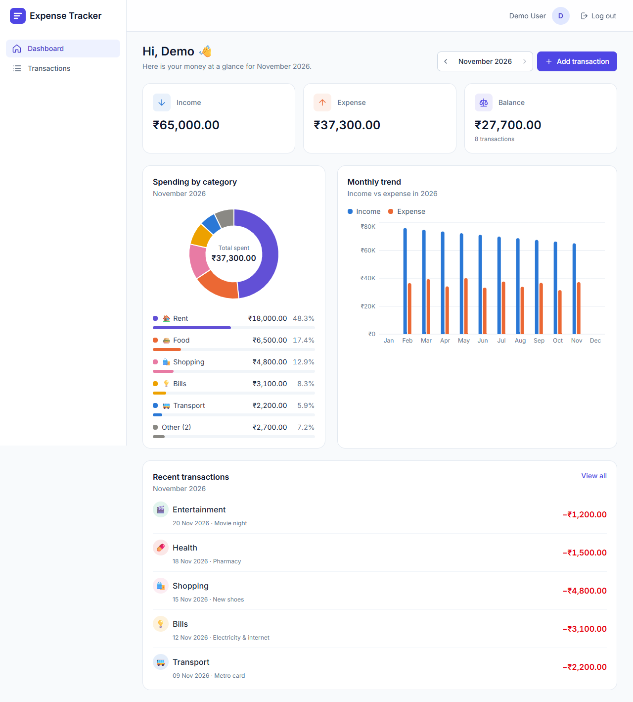
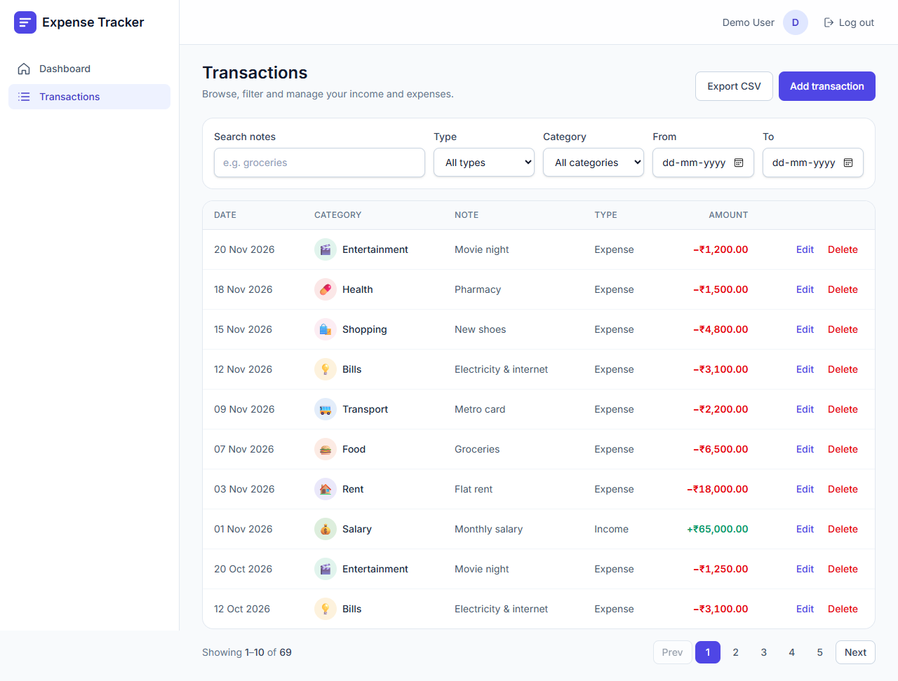
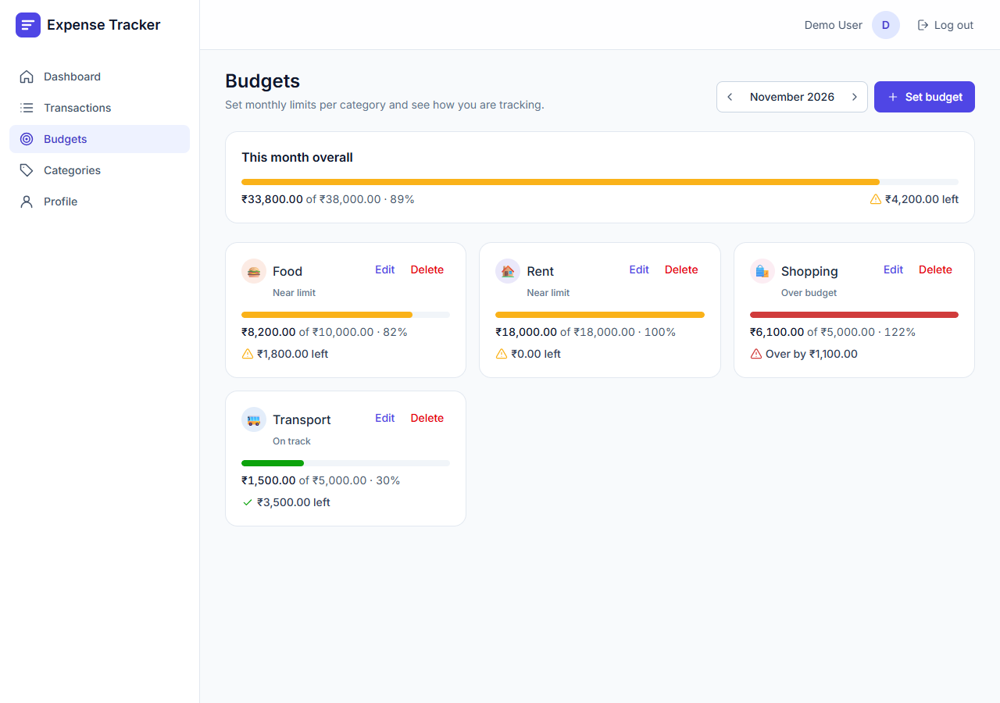
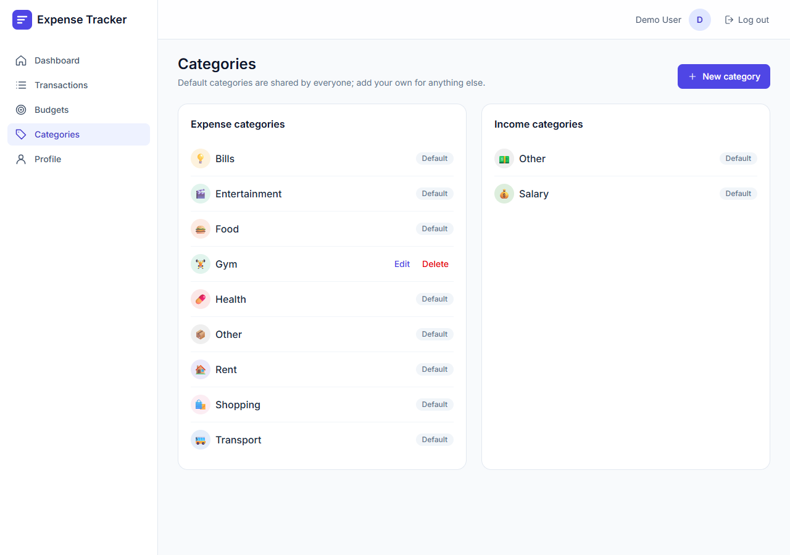
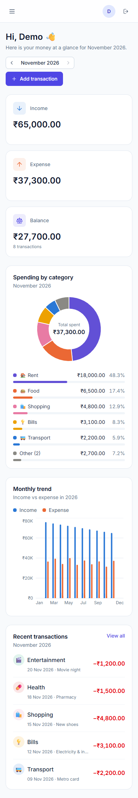

# Expense Tracker

A full-stack **MERN** app (MongoDB, Express, React, Node.js) for tracking income and expenses,
organising them by category, setting monthly budgets and understanding spending through
summaries and charts. Every user's data is private behind JWT authentication.



## Features

- **Accounts** — register, log in, update profile and currency, change password (old sessions are revoked)
- **Transactions** — add, edit and delete income/expenses; filter by date range, type, category and note search; paginated list; CSV export
- **Categories** — 10 shared defaults plus your own custom categories with icon and color
- **Budgets** — monthly limit per expense category with on-track / near-limit / over status
- **Dashboard** — monthly income, expense and balance, spending by category (donut + ranked list), month-by-month trend chart and recent transactions
- **Responsive** — tables turn into cards and the sidebar becomes a drawer on mobile
- **Accurate money** — amounts are stored as integer minor units (paise/cents) and only formatted for display

## Tech stack

| Layer | Technology |
| --- | --- |
| Frontend | React 19 (Vite), React Router, Tailwind CSS v4, react-hook-form + zod, Recharts, axios, react-hot-toast, date-fns |
| Backend | Node.js 18+, Express 4, Mongoose, JWT, bcryptjs, express-validator, helmet, cors, express-rate-limit, express-mongo-sanitize, morgan |
| Database | MongoDB (Atlas in production) |
| Testing | Jest + Supertest + mongodb-memory-server (API), Vitest + React Testing Library (client) |
| Tooling | ESLint (flat config), Prettier, GitHub Actions CI |

## Screenshots

| Transactions | Budgets |
| --- | --- |
|  |  |
| **Categories** | **Mobile dashboard** |
|  |  |

## Project structure

```
expense-tracker/
├── client/                 # React (Vite) SPA
│   └── src/
│       ├── api/            # axios instance + per-resource API functions
│       ├── components/     # common/, charts/, transactions/, budgets/, categories/, dashboard/, profile/, layout/
│       ├── constants/      # routes, config, palette, validation limits
│       ├── context/        # AuthContext (Context API + useReducer)
│       ├── hooks/          # useAuth, useFetch, useTransactionFilters, ...
│       ├── pages/          # one file per route
│       ├── routes/         # ProtectedRoute, PublicOnlyRoute
│       ├── utils/          # formatMoney, formatDate, ...
│       └── validation/     # zod schemas
├── server/                 # Express REST API
│   ├── src/
│   │   ├── config/         # env.js, db.js
│   │   ├── constants/
│   │   ├── controllers/    # thin HTTP layer
│   │   ├── middleware/     # auth, validate, rate limit, error, notFound
│   │   ├── models/         # User, Category, Transaction, Budget
│   │   ├── routes/
│   │   ├── services/       # business logic + aggregation pipelines
│   │   ├── utils/          # asyncHandler, ApiError, generateToken, csv, ...
│   │   ├── validators/     # express-validator rules
│   │   ├── app.js
│   │   └── server.js
│   └── tests/
├── docs/                   # deployment guide, screenshots
├── render.yaml             # Render blueprint for the API
└── .github/workflows/ci.yml
```

Backend requests flow **Route → Controller → Service → Model**, with validation, auth and a
central error handler as middleware.

## Getting started

**Prerequisites:** Node.js 22.22+ or 24.15+, npm, and MongoDB (local or a free [Atlas](https://www.mongodb.com/atlas) cluster).

```bash
git clone https://github.com/raushan95a/TrackExpense.git
cd TrackExpense

# API
cd server
npm install
cp .env.example .env        # fill in MONGO_URI and JWT_SECRET
npm run dev                 # http://localhost:5000/api/v1/health

# Client (new terminal)
cd client
npm install
cp .env.example .env
npm run dev                 # http://localhost:5173
```

Default categories are seeded automatically when the API starts.

### Environment variables

**server/.env**

| Variable | Example | Description |
| --- | --- | --- |
| `PORT` | `5000` | API port |
| `MONGO_URI` | `mongodb://127.0.0.1:27017/expense_tracker` | MongoDB connection string |
| `JWT_SECRET` | long random string | Secret used to sign tokens — generate with `node -e "console.log(require('crypto').randomBytes(48).toString('hex'))"` |
| `JWT_EXPIRES_IN` | `7d` | Token lifetime |
| `CLIENT_URL` | `http://localhost:5173` | Allowed browser origin(s) for CORS, comma-separated |
| `NODE_ENV` | `development` | `development`, `production` or `test` |
| `TRUST_PROXY` | `0` | Reverse proxies in front of the API (`1` on Render/Railway) |

**client/.env**

| Variable | Example | Description |
| --- | --- | --- |
| `VITE_API_URL` | `http://localhost:5000/api/v1` | Base URL of the API |

Never commit `.env` files; only the `.env.example` templates are tracked.

### Scripts

| Location | Command | What it does |
| --- | --- | --- |
| server | `npm run dev` | Start API with auto-reload (nodemon) |
| server | `npm start` | Start API (production) |
| server | `npm test` | API tests on an in-memory MongoDB |
| server | `npm run test:coverage` | Tests with coverage report |
| client | `npm run dev` | Vite dev server |
| client | `npm run build` | Production build to `client/dist` |
| client | `npm test` | Component and unit tests (Vitest) |
| both | `npm run lint` / `npm run format` | ESLint / Prettier |

## API

Base URL: `/api/v1`. Every route except `register`, `login` and `health` needs
`Authorization: Bearer <token>`. All amounts are **integers in minor units** (₹250.50 → `25050`).

| Method | Endpoint | Description |
| --- | --- | --- |
| GET | `/health` | Service and database status |
| POST | `/auth/register` | Create account → `{ user, token }` |
| POST | `/auth/login` | Log in → `{ user, token }` |
| GET | `/auth/me` | Current user |
| PUT | `/auth/profile` | Update `name`, `currency` |
| PUT | `/auth/password` | Change password → new `token` (older tokens revoked) |
| GET | `/transactions` | List; query `page`, `limit` (≤100), `from`, `to`, `category`, `type`, `q` |
| POST | `/transactions` | Create `{ type, amount, category, date?, note? }` |
| GET | `/transactions/:id` | Get one |
| PUT | `/transactions/:id` | Update |
| DELETE | `/transactions/:id` | Delete |
| GET | `/transactions/export` | CSV download (same filters as list) |
| GET | `/categories` | Defaults + your own; optional `type` |
| POST | `/categories` | Create `{ name, type, icon?, color? }` |
| PUT | `/categories/:id` | Update your own category |
| DELETE | `/categories/:id` | Delete (409 if used by transactions; its budgets are removed) |
| GET | `/budgets?month=YYYY-MM` | Budgets with `spent`, `remaining`, `percentUsed`, `isExceeded` |
| POST | `/budgets` | Create or update `{ category, month, limit }` |
| DELETE | `/budgets/:id` | Delete |
| GET | `/analytics/summary?month=YYYY-MM` | Income, expense, balance, count |
| GET | `/analytics/by-category?month=YYYY-MM&type=expense` | Totals per category with percentage |
| GET | `/analytics/monthly?year=YYYY` | 12 months of income/expense |

**Response format**

```json
{ "success": true, "data": { }, "message": "Transaction created" }
{ "success": false, "message": "Validation failed", "errors": [{ "field": "amount", "msg": "Amount must be a positive integer in minor units (e.g. paise)" }] }
```

Status codes: `200`, `201`, `400` validation, `401` auth, `403` forbidden, `404` not found,
`409` conflict, `413` body too large, `429` rate limited, `500` server error.

## Security

- Passwords hashed with bcrypt (12 rounds) and never returned by the API
- JWT (7-day expiry); changing the password invalidates older tokens
- Every query is scoped to the signed-in user; other users' records return 404
- Helmet headers, CORS allow-list, 10 kb body limit, input validation and NoSQL-injection sanitising
- Rate limits: 10 requests / 15 min on register, login and password change; 100 / 15 min on other `/auth` routes
- CSV export neutralises spreadsheet formula injection

## Testing

```bash
cd server && npm test     # 85 API tests: auth, user isolation, CRUD, filters, CSV, analytics, budgets
cd client && npm test     # 48 tests: money/date/API-URL utils, schemas, ProtectedRoute, Login/Register pages, SummaryCards
```

CI runs lint, tests and the client build on every push and pull request.

## Deployment

MongoDB Atlas + Render (or Railway) for the API + Vercel for the client.
Step-by-step guide: **[docs/DEPLOYMENT.md](docs/DEPLOYMENT.md)**.

## Live demo

_Add your deployed URL here._

## Author

Raushan Kumar — [github.com/raushan95a](https://github.com/raushan95a)
